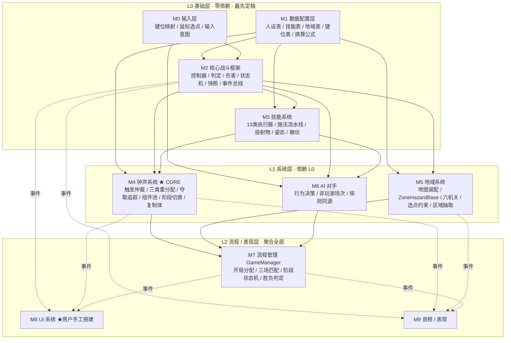
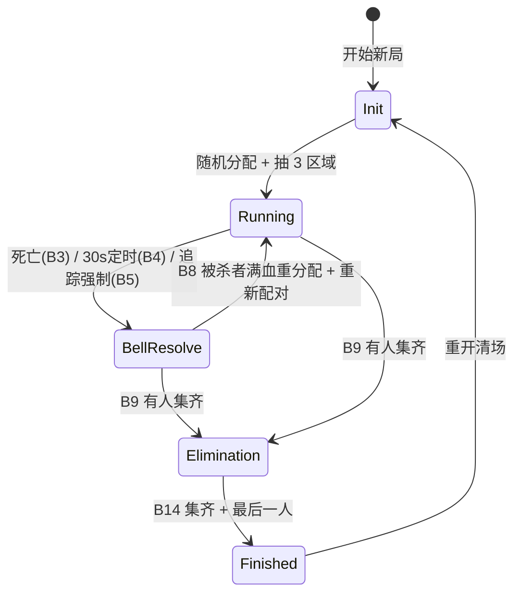

# 《钟声》项目架构分析（详版 v2 · Markdown）

> **来源**：`钟声.docx`（全文 182 段逐条核对）
> **项目类型**：横版 2D 多人竞技 · 6 人设 / 6 地域 / 3 场并行 1v1 / 钟声重分配机制
> **目标引擎**：Unity
> **文档性质**：架构设计文档。用于对齐模块边界、数据口径、分工与排期；**不含可编译实现代码，不自动生成任何 Unity UI 层级**。
> **配套文件**：`钟声_架构分析.html`（v1 简版）、`钟声_架构分析_详版.html`（v2 可视化版）

---

## 目录

| 章节 | 内容 |
|---|---|
| [0](#0-设计约束与阅读约定) | 设计约束与阅读约定 |
| [1](#1-需求全量数据字典) | 需求全量数据字典 |
| [2](#2-架构总览与依赖矩阵) | 架构总览与依赖矩阵 |
| [3](#3-模块--子模块详细分工) | 模块 → 子模块详细分工 |
| [4](#4-数据模型与接口契约) | 数据模型与接口契约 |
| [5](#5-关键流程时序与状态机) | 关键流程时序与状态机 |
| [6](#6-详细排期-wbs) | 详细排期 WBS |
| [7](#7-ui-协作契约用户手工搭建--inspector-绑定) | UI 协作契约 |
| [8](#8-设计决策与风险清单) | 设计决策与风险清单 |
| [9](#9-待确认问题文档歧义--不一致) | 待确认问题 |

---

## 0. 设计约束与阅读约定

| 项 | 约定 |
|---|---|
| **协作方式** | **UI 由用户在 Unity 编辑器手工搭建，引用拖入 Inspector**；代码侧只提供可序列化字段、公开属性与事件，**不自动生成 UI 层级、不自动挂载、不代码建控件**。见 §7 绑定清单。 |
| **代码定位** | 本文中的 `接口 / 字段 / 事件` 均为**架构契约示意**，用于对齐模块边界，不是可直接编译的实现，也不代表会由工具批量生成代码。 |
| **工作量单位** | 「相对量」为单人开发的粗略相对估算（人日量级），用于排先后与识别关键路径，非交付承诺。 |
| **分层标记** | `L0 基础层`（零/低依赖，最先做）· `L1 系统层`（依赖 L0）· `CORE`（玩法核心）· `L2 流程/表现层`（聚合全部） |
| **命名冲突预警** | 文档存在**两种「钟声」**：① 全局钟声（M4，重分配特质/技能/位置）；② 钟塔地域的局部钟声（M5，每 10 秒三选一）。实现上必须分开命名，例如 `GlobalBell` 与 `ZoneBell_Tower`。 |

---

## 1. 需求全量数据字典

### 1.1 全局参数

| 参数 | 值 | 出处 / 说明 |
|---|---|---|
| 地图尺寸 | **25 格 × 12 格**（横版 2D） | §三 简介 |
| 角色碰撞体 | **1 格宽 × 2 格高** | 相对地图长宽，是全部「格」判定的基准 |
| 区域数 / 角色数 | **6 / 6** | §零 |
| 每局并行战斗 | **3 场 1v1**，场地从 6 区域随机选 3 个 | §零 |
| 定时钟声 | **每 30 秒**，仅在「无人集齐人设」且「未触发死亡钟声」时，种类随机 | §零 [005] |
| 移速换算 | `移速(格/秒) = 速度值 × 0.03` | 验证：130→3.9、108→3.24、72→2.16、110→3.3、90→2.7，全表一致 |
| 减伤换算 | `减伤% ≈ 防御 ÷ 5` | 70→14%、82→16.4%、90→18%、96→19.2%、120→24% 一致；**但 75→12.5% 不符（应为 15%）**，见 §9-Q1 |
| 跳跃 | 全角色统一 2 格；**跳跃过程中可移动、可攻击** | §零 注(4)，对空中状态机有硬性要求 |
| 闪避（标准规格） | 向输入方向后退 1 格（无输入则背后）／冷却 0.5s／无敌帧 0.1s | 6 角色全同，属 M2 通用能力，不进角色配置表 |
| 技能等级 | 本我=伤害型；自我=生存型（护盾/治疗/减伤）；超我=辅助/控制/增幅型 | §二，每人设固定带 3 个不同等级技能 |

### 1.2 六人设基础数值总表

| 人设 | 生命 | 防御 | 减伤 | 速度 | 移速(格/s) | 攻速(间隔 s) | 跳跃 | 定位 |
|---|---|---|---|---|---|---|---|---|
| **剑客** | 100 | 70 | 14% | **130（最高）** | 3.9 | 0.7 | 2 | 最高机动，高频连击 |
| **蒸汽机械师** | 110 | 82 | 16.4% | 108 | 3.24 | 0.8 | 2 | 近身最高爆发，打完拉开 |
| **斯巴达战士** | 116 | **120（最高）** | **24%** | **72（最低）** | 2.16 | 0.9 | 2 | 狂战士 / 举盾坦 |
| **精灵游侠** | **75（最低）** | 75 | 12.5% ⚠️ | 110 | 3.3 | **0.6（最快）** | 2 | 射程 8 格最远，脆皮 |
| **钟表师** | 96 | 96 | 19.2% | 108 | 3.24 | 0.8 | 2 | 时间系：回溯 / 减速 / 致死撤销 |
| **力士** | **120（最高）** | 90 | 18% | 90 | 2.7 | 0.9 | 2 | 近战控制 / 击退 / 眩晕 |

> **数据形态结论**：数值差异全部可配置（M1 一张表即可表达），但技能行为差异极大（散弹、折返弹、姿态切换、地形生成、时间回溯、分段冲撞），因此 **M3 必须是「数据定义 + 效果执行器」双部分**，不能只靠配表。

### 1.3 六人设技能全量表

#### ① 剑客（建议作为首个打通链路的角色）

| 槽位 | 名称 | 关键参数 |
|---|---|---|
| 特质（被动） | 剑意 | 每次造成伤害（平A/任意技能）得 1 层，持续 2s，上限 3 层，叠层刷新；每层 **+10% 最终伤害**（全局增伤乘区，不绑定技能）。设计意图：靠短 CD 连击稳定维持满层。 |
| 普攻 | 近战横斩 | 正前方 1 格长 × 2 格宽矩形；前摇 0.15s；伤害 4 |
| 本我 | 突进斩 | 向输入方向突进 2 格，覆盖长 3 × 宽 2 线性区域；伤害 12；CD 2s（**全表最短**） |
| 自我 | 敛息 | 立即清除自身所有负面效果；1.5s 内 +30% 减伤；回复 10 生命；CD 5s |
| 超我 | 剑域 | 自身周围 2.5 格半径领域，施法者在域内时其 2s 内攻击转化为等量全领域剑气；域内敌人移速 −30%、受到伤害 +15%（易伤）；CD 5s |

#### ② 蒸汽机械师

| 槽位 | 名称 | 关键参数 |
|---|---|---|
| 特质 | 过载损耗 | 实际移速 = 3.24 × (当前生命 / 110)，回血同步恢复，无永久层数；每累计受击 3 次进入「蓄势」，下次平A命中 ≥1 枚时击退目标 1 格并消耗蓄势（未命中不消耗），触发后受击计数清零 |
| 普攻 | 蒸汽铳（散弹） | 正前方 5 格扇形，总散射角 28°（±14°）；弹速 6 格/s（最远 0.83s）；前摇 0.2s；4 枚散弹，每枚 2 伤害；角度 −14°/−4.7°/+4.7°/+14° |
| 本我 | 高压喷射 | 前方 4 格扇形，总散射角 36°（±18°）；7 枚蒸汽弹，每枚 2 伤害；命中 ≥3 枚时目标移速 −30% 持续 0.5s；弹速 6 格/s（0.67s）；前摇 0.3s；CD 4s；角度 ±18/±12/±6/0 |
| 自我 | 紧急排气 | 原地停止 0.5s（**无无敌帧**）；立即回复 15；清除自身所有减速/定身；随后 2s 受伤 −25%；CD 5s |
| 超我 | 高性能模式 | 2s 内移速与攻击力 ×1.5；结束后 1s 内两者降为 70% 再恢复；CD 5s |

#### ③ 斯巴达战士

| 槽位 | 名称 | 关键参数 |
|---|---|---|
| 特质 | 斯巴达韧性 | 「半举盾」姿态：基础防御 +8；每秒回复 0.5 生命 |
| 普攻 | 长矛突刺 | 前方 2 格长 × 1 格宽矩形；前摇 0.2s；伤害 5 |
| 本我 | 战阵横扫 | 前方 2×2 矩形蓄力横扫；伤害 10；命中目标移速 −20% 持续 1.5s；CD 4s |
| 自我 | 绝对防御 | 「全举盾」2s：正前方 180° 扇形受伤 **−90%**；自身移速 −50%；**禁止普攻与本我技能**；可再次点击提前解除；CD 5s |
| 超我 | 狂战 | 投矛前方 5 格（弹速 8 格/s，宽 1 格），首个目标 8 伤害；随后「单刀狂战」3s：防御 −30%，平A 改单刀（射程 1 格、单发 2 伤害、间隔 0.5s）；姿态结束后 **1.5s「重新装备」硬直**（移速 −30%、无法攻击）；CD 6s |

#### ④ 精灵游侠

| 槽位 | 名称 | 关键参数 |
|---|---|---|
| 特质 | 精灵之目 | 射程 8 格；平A 或本我技能命中得 1 层「风之优雅」，2s、上限 3 层，每层 +5% 移速；满 3 层时下一次平A 消耗层数变「重箭」，该次伤害 +2 |
| 普攻 | 游侠短弓 | 前方 8 格长 × 1 格宽直线弹道；弹速 10 格/s（0.8s）；前摇 0.15s；伤害 3 |
| 本我 | 破甲重箭 | 射程 8 格宽 1 格；首个目标 8 伤害 + 移速 −30% 持续 1.5s；弹速 12 格/s（0.67s）；前摇 0.2s；CD 4s |
| 自我 | 自然恩赐 | 原地停止 0.3s；回复 12；清除自身 1 个持续伤害或减速/定身；随后 1.5s 减伤 20%；CD 5s |
| 超我 | 缚地荆棘 | **鼠标指定**前方 4 格内任一格为中心，生成长 3 格 × 高 1 格荆棘地形，持续 2s；敌人试图离开时被缠绕定身 0.75s；游侠自身穿越不受影响；CD 4s（**唯一需要鼠标选点的技能**） |

#### ⑤ 钟表师（时间系，对框架要求最高）

| 槽位 | 名称 | 关键参数 |
|---|---|---|
| 特质 | 逆时 | 受到**必定致死**一击时，把自身状态（生命、坐标、增益/减益）倒回 3 秒前，该次致死伤害作废；**CD 30s** |
| 普攻 | 时钟飞刃 | 前方 5 格 × 宽 1 格直线；弹速 8 格/s（0.62s）；前摇 0.2s；去程命中 4 伤害，到最远端**自动折返**，回程再 4 伤害；**飞刃未回归前不能发出第二次攻击** |
| 本我 | 催龄 | 前方 2×4 格内敌人造成 8 点「岁月侵蚀」；目标移速/攻速/防御全部 −20% 持续 2s；前摇 0.4s；CD 4s |
| 自我 | 回溯 | 生命值与全部增益/减益还原到 3 秒前，清除所有持续伤害；**只还原生理数值，不还原坐标**；单次回复上限 25；若 3 秒前生命更低则不倒扣；CD 8s |
| 超我 | 慢摆 | 改变周围半径 5 格时间流速 2s：域内目标动作速度 ×0.6（移速、攻速、施法读条、起跳动作均变慢）；前摇 0.4s；CD 6s |

#### ⑥ 力士

| 槽位 | 名称 | 关键参数 |
|---|---|---|
| 特质 | 力量 | 对同一目标每累计第 3 次平A 附带 1s 眩晕，计数清零；按目标独立计数，1.5s 未命中该目标清零；目标眩晕结束后获得 1.5s 眩晕抗性（免疫新眩晕） |
| 普攻 | 出拳 | 前方 1 格长 × 2 格宽矩形；前摇 0.2s；伤害 3 |
| 本我 | 崩进冲撞 | 前摇 0.25s 后直线冲刺 10 格/s、极限 5 格，判定 1×2，命中首个敌人即停，冲刺期**霸体（免疫击退）**但受伤正常；**分段判定**：1格=4伤+击退1／2格=5伤+击退1.5／3格=6伤+击退2／4格=8伤+击退0.5+眩晕0.6s／5格=10伤+眩晕1.0s；未命中跑满 5 格后 0.3s 硬直；CD 4s |
| 自我 | 沉腰调息 | 2s 调息：无法攻击、受伤 −25%、免疫击退；每 1s 结算一次（该段未受伤回 4，受伤回 2）；2s 全程未被攻击则额外 +8 护盾持续 3s（完美调息）；可提前结束但无护盾；CD 5s |
| 超我 | 虚手锚定 | 前摇 0.3s，前方 4 格长 × 2 格宽直线（遇墙在墙前停止），命中首个敌人 2 伤害并记为「锚点」；目标 1s 内可自由行动，1s 结束时被**强制拉回锚点坐标**并定身 0.5s；CD 5s |

> **技能系统抽象结论**：30 个技能槽（6 人设 × 5 槽：特质/普攻/本我/自我/超我）覆盖 **13 类效果原语**：① 直线弹道 ② 扇形多弹丸 ③ 折返弹丸 ④ 矩形/圆形即时判定 ⑤ 突进/冲刺（含分段判定） ⑥ 位移/强制拉回 ⑦ 击退 ⑧ 眩晕/定身/减速 ⑨ 增益减益与乘区 ⑩ 治疗与护盾 ⑪ 净化 ⑫ 姿态/状态切换 ⑬ 地形生成与时间流速场。**这 13 类原语就是 M3 的 executor 清单，是项目工作量最集中的地方。**

### 1.4 六地域机制参数表

| 地域 | 场地形态 | 核心机制（全量参数） | 依赖的框架能力 |
|---|---|---|---|
| **Z1 雨夜竹林** | 雨夜，画面压至接近全黑；平地 | 平时看不见地形；落雷基础间隔 **0.8~1.2s 随机**；每满 1s 额外判定，约 50% 概率在该秒内任意时刻**追加一道**；每次落雷照亮全场约 **0.3s**；每道雷 **2%** 概率为伤害雷（红紫色），命中扣 **40 血 + 眩晕 1s**；伤害雷必定落到地面某一格，除非提前劈中参与者 | 全局光照/后处理、随机计时器、网格选点、高伤+控制 |
| **蒸汽井盖** | 锅炉房内部，纯平地；地面由井盖一格挨一格无缝铺满 | 每 **4~5s** 一个喷发批次：随机挑约 **20%** 井口同时喷汽，且**该批井口不连成 4 个以上**（保证总有落脚空隙）；喷发前 **1s** 井口先泄漏白汽预警；喷发瞬间站在井口上的人被垂直顶飞，**5 点伤害** | 网格占用表、带约束的随机选点、预警表现、垂直位移/击飞 |
| **竞技场** | 圆形看台围出的沙地，纯平地，无机关无地形 | 每 **15s** 若双方未分胜负，双方各 **+15% 攻击力，可叠加**；加成**只在场地内生效，离开区域即失效** | 区域归属判定、可叠加增益、离场清除 |
| **层林** | 林间小道，纯平地；地面不断长出植物 | 每 **4~6s** 一批，每批数量约场内空地 **20%**；位置全随机、散落、**不连成 4 株以上**；每株冒芽到长高约 **0.7s**，成熟维持约 **2s** 后凋亡消失不留残骸；成熟期从植株旁经过被缠住 **定身 0.8s**；单株范围 1×1、0 伤害、**每株每批只缠一次** | 动态实体生成/销毁、带约束随机选点、一次性触发标记、地形碰撞 |
| **钟塔** ⚠️局部钟声 | 钟塔内部，纯平地；节奏由钟声驱动 | 每 **10s** 钟声响起，**随机三选一，同时施加双方**：① 双方位置与血量倒回 **3 秒前**；② 双方动作速度 +15% 持续 4s；③ 双方动作速度 −15% 持续 4s | **3 秒状态快照与回滚**（与钟表师共用）、动作速度全局缩放 |
| **洞窟** | 纯平地 | 每 **8s** 上方掉落 **3~10 块**岩石，尺寸 1×1；掉落前 **1s** 地面出现黑色阴影提示；命中后 **−10 生命** | 预警表现、随机数量与选点、下落碰撞判定 |

> **共性提炼**：6 个地域中有 **5 个**是「定时批次 + 随机选点 + 提前 1s 预警 + 命中结算」的同一套骨架（竹林/井盖/层林/洞窟/竞技场计时器），只有钟塔是「三选一状态效果」。因此 **M5 应抽象出 `ZoneHazardBase` 计时器基类**，各地域只实现选点策略与命中效果，避免 6 份重复计时代码。

### 1.5 钟声规则条款表（全局钟声 / M4）

| 编号 | 条款 | 规则 | 阶段 |
|---|---|---|---|
| B1 | 三种钟声 | 特质钟声：收集场上剩余特质 → 打乱 → 重新分给场上所有人；技能钟声：同理，但**仍保持每种等级各一个**；位置钟声：场上剩余的人位置互换 | 通用 |
| B2 | 作用范围 | 三种钟声的执行目标都是**场上剩下的所有角色**（全局，不是单场 1v1） | 通用 |
| B3 | 触发源 ①：死亡 | 出现死亡**一定**触发钟声，且**必定为位置钟声** | 通用 |
| B4 | 触发源 ②：定时 | 无人集齐人设时，**每隔 30s** 触发一次，种类随机（前提：期间未因死亡触发） | 普通阶段 |
| B5 | 触发源 ③：追踪强制 | 击杀后选择追踪时，**本次钟声必定触发位置交换** | 普通阶段 |
| B6 | 击杀收益 | 杀死对方后二选一：**夺取**其 1 个特质或技能；或**追踪**自己需要的技能/特质持有者 | 通用 |
| B7 | 追踪持续 | 追踪**持续保持两次钟声**；若下次钟声为人为触发，则追踪者与被追踪者**不能成为追踪对象** | 普通阶段 |
| B8 | 死亡后（普通阶段） | 无人集齐一套特质+技能时，被杀方被重新分配到 6 区域中之一，**生命恢复至满**，钟声重新匹配对手，仍是 3 场 1v1 | 普通阶段 |
| B9 | 阶段切换 | **有人集齐**则进入淘汰制，「和之前规则多数一致」 | 淘汰制 |
| B10 | 淘汰制差异 ① | 追踪变为**一次性** | 淘汰制 |
| B11 | 淘汰制差异 ② | 被淘汰者的所有技能与特质落入**组件池**，胜者可**选择一个带走**；若不选择替换技能/特质，可选择**恢复 20% 生命** | 淘汰制 |
| B12 | 淘汰制差异 ③ | 位置钟声敲响且剩余人数为**奇数**时，落单者与**自己的复制体**对决：复制体复制当前所有东西，但**生命与防御低 20%**；剩余人数为偶数时（复制体）**消失** | 淘汰制 |
| B13 | 集齐者豁免 | 集齐人设的角色，**不会再被钟声随机分配技能和特质** | 通用 |
| B14 | 胜利条件 | 集齐完整特质与技能、合成一个完整人设，**并且**只剩下最后一个人 | 终局 |

### 1.6 键位表

| 按键 | 动作 | 备注 |
|---|---|---|
| `W A S D` | 上下左右 | 横版 2D 仍保留四向（含跳跃中可移动） |
| `鼠标左键 / ?` | 平A / 闪避 | 文档原文「鼠标左键/：平A/闪避」斜杠后缺失，见 §9-Q4 |
| `空格` | 跳跃 | 2 格；跳跃中可移动与攻击 |
| `1 2 3` | 对应 1~3 号技能 | 对应本我/自我/超我三级技能 |
| `Esc` | 退出 / 主菜单 | 暂停与菜单入口 |
| 自定义 | 映射表 + 本地存储 | 文档写 `localStorage`；Unity 下应落 `PlayerPrefs` 或本地 JSON（见 §9-Q7） |

---

## 2. 架构总览与依赖矩阵

### 2.1 分层依赖图

**依赖读法与关键结论**

- **M1 是唯一零外部依赖模块；M2 是唯一被所有上层模块引用的运行时框架** —— 二者共同构成「地基」，任何返工都会全链路传导。
- **M0 输入层被提升到 L0**，因为「玩家 / AI 同构」要求输入源可替换（M6 只是 M0 的另一个实现），否则 AI 要重写一遍战斗。
- **M2.5 状态快照被单独列出**：钟表师「逆时」「回溯」与钟塔「倒回 3 秒」三处共用，属于跨模块的隐性公共能力。
- **M4 钟声系统是全局唯一有权改写「角色 ↔ 特质/技能/位置」映射的模块**；M7 只读它产出的 `MatchState`。
- **M8 UI 与 M9 表现只订阅事件、不反向写逻辑**；因此二者可全程并行、且不影响关键路径。

### 2.2 依赖矩阵

`●` = 强依赖（缺其不可编译/不可运行）；`○` = 弱依赖（仅需事件/只读数据）；空白 = 无依赖。行 = 依赖方，列 = 被依赖方。

| 依赖方 ↓ / 被依赖 → | M0 | M1 | M2 | M3 | M4 | M5 | M6 | M7 | M8 | M9 |
|---|:--:|:--:|:--:|:--:|:--:|:--:|:--:|:--:|:--:|:--:|
| **M0 输入层** | — | ○ | | | | | | | | |
| **M1 数据配置** | | — | | | | | | | | |
| **M2 战斗框架** | ● | ● | — | | | | | | | |
| **M3 技能系统** | ○ | ● | ● | — | | | | | | |
| **M4 钟声系统** | | ● | ● | ● | — | ○ | | ○ | | |
| **M5 地域系统** | | ● | ● | ○ | | — | | | | |
| **M6 AI 对手** | ● | ○ | ● | ● | ○ | | — | | | |
| **M7 流程管理** | | ○ | ○ | | ● | ● | ● | — | | |
| **M8 UI** | ○ | ○ | ○ | ○ | ○ | | | ○ | — | |
| **M9 音频/表现** | | | ○ | ○ | ○ | ○ | | ○ | | — |

> **关键路径判定**：按「被依赖次数」排序 M2(7) > M1(6) > M3(5) > M4(4) > M5/M6 > M7。M2 与 M1 任意一个返工，影响面覆盖 6~7 个模块 —— 从量化上证明「阶段 ① 先定稿 M1/M2」的必要性。

---

## 3. 模块 → 子模块详细分工

### M1 数据配置层 `L0` · 相对量 2~3 人日 · 零依赖 · 最先

| 子模块 | 职责 | 输入 → 输出 | 验收标准 |
|---|---|---|---|
| 1.1 人设数值表 | 6 行 × 7 列基础属性；统一闪避规格 | 策划数值 → ScriptableObject 集合 | 改表后无需改代码即可生效；移速/减伤由公式自动算出 |
| 1.2 技能定义表 | 30 个技能槽的静态参数（CD/前摇/伤害/范围/弹速/散射角/持续时间） | §1.3 全表 → 技能 ID + 参数字典 | 每个技能有唯一 ID；可被 M4 按 ID 重分配 |
| 1.3 地域参数表 | 6 地域的间隔、概率、数量、伤害等可调参数 | §1.4 → 地域配置 | 机关计时器全部读表，不硬编码 |
| 1.4 键位映射表 | 默认键位 + 自定义映射的序列化格式 | §1.6 → 映射字典 + 本地存储 | 改键后重启仍生效 |
| 1.5 换算公式 | 移速 = 速度×0.03；减伤 = 防御÷5（**需先确认 Q1**） | 基础值 → 派生值 | 与文档 6 行数值逐条对齐（游侠例外需确认） |

### M2 核心战斗框架 `L0` · 相对量 8~12 人日 · 被 7 个模块依赖 · 关键路径最长

| 子模块 | 职责 | 输入 → 输出 | 验收标准 |
|---|---|---|---|
| 2.1 角色控制器 | 四向移动、2 格跳跃、**空中可移动可攻击**、闪避（1 格/0.5s CD/0.1s 无敌帧）、击飞/击退/强制拉回 | 输入意图 + 角色配置 → 位置/状态 | 跳跃中可平A；无敌帧内受击不掉血；击退不穿墙 |
| 2.2 命中判定 | 统一「格」坐标下的 矩形 / 扇形 / 圆 / 直线弹道 判定，朝向与鼠标选点 | 技能范围描述 → 命中目标集合 | 散弹按角度分布命中数正确；直线弹道命中首个目标即停 |
| 2.3 伤害与减伤 | 防御减伤、最终伤害乘区（剑意 +10%/层、易伤 +15%）、护盾吸收、致死判定 | 原始伤害 → 实际扣血 + 致死标志 | 乘区叠加顺序明确且可配置；致死拦截（逆时）可插入 |
| 2.4 Buff / 状态机 | 增减益（三围百分比、动作速度、攻击力）、控制（眩晕/定身/减速/霸体/抗性）、姿态（举盾/狂战/调息）、持续伤害、净化 | 效果描述 → 带时长的状态列表 | 眩晕抗性 1.5s 生效；举盾期禁平A/本我；姿态结束硬直正确 |
| 2.5 **状态快照 / 回滚** | 按固定频率（建议 0.1s）环形缓存 3 秒内的 生命/坐标/增益减益；支持「只还原生理数值不还原坐标」与「全还原」两种模式 | 运行时状态 → Snapshot；回滚指令 → 状态复位 | 钟表师逆时、回溯、钟塔钟声三者复用同一组件，结果符合各自定义 |
| 2.6 事件总线 | 统一发布 `OnDamaged / OnDied / OnHealed / OnBuffChanged / OnSkillCast / OnStateRestored` | 框架内部 → 全局可订阅事件 | M4/M7/M8/M9 均只通过事件感知战斗，不反向持有引用 |

### M3 技能系统 `L0` · 相对量 12~18 人日（本项目最大块）· 建议先做剑客 5 槽打穿

| 子模块 | 职责 | 输入 → 输出 | 验收标准 |
|---|---|---|---|
| 3.1 效果执行器 | §1.3 提炼的 **13 类原语** | 技能定义 + 施法上下文 → 效果实例 | 新增一个技能 = 组合已有原语 + 配表，不写新框架代码 |
| 3.2 施法流水线 | 前摇 → 生效 → 后摇 → CD；可打断/禁止规则（举盾、调息） | 技能 ID → 时序状态机 | 前摇期被打断行为一致；CD 从生效点起算 |
| 3.3 投射物 | 直线运动、到端点折返、未回归禁止再次攻击、散射角均分、命中首个目标即停 | 弹道参数 → 飞行实体 | 时钟飞刃去/回程各 4 伤害且回归前不能二次攻击 |
| 3.4 姿态系统 | 举盾/单刀狂战/调息 等整套替换普攻与技能可用性的状态 | 姿态定义 → 技能槽重绑 | 狂战结束 1.5s 硬直、完美调息护盾结算正确 |
| 3.5 特质被动 | 6 个常驻被动的事件订阅式实现（叠层、计数、致死拦截、移速随血量） | 战斗事件 → 被动效果 | 剑意/风之优雅叠层刷新、力量按目标独立计数、逆时 30s CD 均正确 |

### M4 钟声系统 `CORE` · 相对量 8~12 人日 · 玩法灵魂 · 阶段 ③ 关键路径

| 子模块 | 职责 | 输入 → 输出 | 验收标准 |
|---|---|---|---|
| 4.1 触发仲裁 | 合并三触发源并定优先级：死亡(B3, 必定位置) > 追踪强制(B5, 必定位置) > 30s 定时(B4, 随机)；定时钟期间被死亡打断则重置 | 事件 + 计时 → 一条 `BellCommand` | 三类触发不重复不冲突；死亡后定时计数归零 |
| 4.2 三类重分配 | 特质池/技能池/位置池的收集 → 打乱 → 重分；**技能重分仍保证每人本我/自我/超我各一**；位置互换 | 全局映射表 → 新映射表 | 重分后每人技能等级不重复；集齐者被豁免(B13) |
| 4.3 击杀收益 | 夺取 1 个特质/技能；或指定追踪目标；淘汰制下改为从组件池选一 / 回 20% 血 | 击杀事件 + 玩家选择 → 映射变更 | 夺取后原持有者对应槽位状态明确（待确认 Q5） |
| 4.4 追踪状态机 | 持续两次钟声；人为触发钟声时追踪双方不可互为对象；淘汰制改一次性 | 追踪关系 → 剩余钟声计数 | 两次钟声后自动解除；B7 限制生效 |
| 4.5 组件池 | 淘汰者的全部技能与特质入池，胜者取一；剩余项处置 | 淘汰事件 → 池 | 池内容可查询、可被 UI 展示 |
| 4.6 阶段切换 | 「有人集齐」→ 淘汰制；规则差异 B10~B12 生效 | 集齐事件 → Phase 枚举 | 切换后普通阶段复活逻辑(B8)不再生效 |
| 4.7 复制体 | 奇数人落单时生成自身复制体（生命/防御 −20%，其余全复制）；偶数时消失 | 剩余人数 → 临时角色 | 复制体参与 1v1 且结算正确（语义待确认 Q3） |
| 4.8 集齐判定 | 判定「集齐一整套特质+技能 → 合成完整人设」，维护豁免名单与胜利条件 | 映射表 → 集齐者列表 | 合成后不再被特质/技能钟声影响；位置钟声是否仍作用需确认(Q6) |
| 4.9 全局映射表 | **唯一权威**：角色 ↔ 特质/技能/位置/对手 的运行时映射；所有重分配在此原地改写 | → `MatchState` 的一部分 | 无第二处可改写该映射，避免状态分叉 |

### M5 地域系统 `L1` · 相对量 6~9 人日 · 6 机关可并行

| 子模块 | 职责 | 验收标准 |
|---|---|---|
| 5.1 地图装配 | 25×12 横版地图、6 个区域容器、1×2 角色体积与格坐标系统一 | 区域边界与格坐标换算全项目一致 |
| 5.2 `ZoneHazardBase` | 定时批次 → 选点 → 提前 1s 预警 → 生效 → 清理 的公共骨架（竹林/井盖/层林/洞窟共用） | 新增机关只需实现选点策略与命中效果 |
| 5.3 六地域机关 | 见 §1.4 全量参数；钟塔用独立 `ZoneBell_Tower` 三选一逻辑 | 逐条对齐参数表；预警表现早于伤害 1s |
| 5.4 带约束选点 | 「约 20%」「不连成 4 个以上」「总留落脚空隙」「全随机散落」等约束 | 任何批次都保证存在可站立格 |
| 5.5 抽取与归属 | 每局从 6 区域随机选 3 个作为 3 场战斗场地；判定角色是否在区域内（竞技场加成离场失效） | 3 场互不冲突；离场即清除区域增益 |

### M6 AI 对手 `L1` · 相对量 5~8 人日 · 阶段 ④

| 子模块 | 职责 | 验收标准 |
|---|---|---|
| 6.1 行为决策器 | 输出与玩家同构的「输入意图」（移动/跳跃/平A/闪避/1~3 技能/鼠标选点） | AI 与玩家调用同一个 M2/M3 入口，代码零分叉 |
| 6.2 非玩家场次 | 另外 2 场 1v1 的模拟运行；可降频/简化表现但不改规则 | AI 场次同样产生死亡、触发钟声、影响全局映射 |
| 6.3 规则同源校验 | 保证「规则和玩家这边一样」（§零 注2） | 用同一套测试用例分别跑玩家/AI 得到一致结果 |

### M7 流程管理 `L2` · 相对量 5~7 人日

| 子模块 | 职责 | 验收标准 |
|---|---|---|
| 7.1 开局分配 | 随机分配特质、技能、位置；抽取 3 个区域 | 每局初始状态合法（技能等级不重复等） |
| 7.2 三场匹配调度 | 6 人 → 3 场 1v1；钟声后按 B8 重新匹配；淘汰制奇数人复制体 | 任意时刻每人恰好在一场战斗中或已淘汰 |
| 7.3 阶段状态机 | `Init → Running(普通) → BellResolve → Running → Elimination → Finished` | 状态转移见 §5.1，无非法跳转 |
| 7.4 胜负判定 | B14：集齐完整人设 + 场上最后一人 | 两条件同时满足才结算 |
| 7.5 结算与重开 | 结算展示、回到主菜单、重新开局清场 | 无残留运行时状态 |

### M8 UI 系统 `L2` · 全程并行 · 用户手工搭建

| 子模块 | 职责 | 说明 |
|---|---|---|
| 8.1 HUD | 双方血条、生命数值、技能 1/2/3 冷却、当前特质与技能槽、追踪目标、增益减益图标 | 全部由用户在编辑器搭建，引用拖 Inspector；代码只暴露可绑定字段与事件，详见 §7 |
| 8.2 钟声提示 | 钟声倒计时（30s）、钟声种类预告、重分配结果弹窗、夺取/追踪选择面板、组件池面板 | 同上 |
| 8.3 菜单 | 主菜单、暂停（Esc）、结算页 | 同上 |
| 8.4 自定义键位 | 按键捕获与映射表编辑、恢复默认、本地持久化 | 同上 |

### M9 音频 / 表现 `L2` · 相对量 3~5 人日 · 全程并行

钟声音效与全屏闪光、竹林照亮 0.3s、井盖白汽预警、洞窟地面黑影、层林植物生长/凋亡、区域机关命中反馈、受击与死亡表现。全部通过订阅 M2.6 事件与 M5 机关事件实现，与逻辑解耦。

---

## 4. 数据模型与接口契约

> 以下为**架构契约示意**，用于对齐模块边界与 Inspector 绑定点；不是可直接编译的实现，也不代表会由工具自动生成代码。

### 4.1 核心运行时实体

| 实体 | 关键字段 | 归属模块 / 说明 |
|---|---|---|
| `CharacterConfig` | id, hp, defense, speed, attackInterval, jump, 减伤派生值 | M1 静态配置（ScriptableObject） |
| `SkillDefinition` | id, tier(本我/自我/超我), cooldown, windup, damage, shape, range, projectileParams, effectRefs[] | M1 静态；`effectRefs` 指向 M3 执行器组合 |
| `TraitDefinition` | id, passiveLogicRef, params | M1 静态 |
| `ZoneConfig` | id, intervalRange, batchRatio, warningLead, damage, constraintRule | M1 静态 |
| `CharacterRuntime` | instanceId, configRef, **traitId, skillIds[3], zoneId, opponentId**, hp, buffs[], stance, snapshotRing, isCompletePersona, isEliminated | M2 运行时实例；**加粗四项由 M4 独占改写** |
| `MatchState` | phase, aliveCharacters[], pairings[3], activeZoneIds[3], traitPool, skillPool, componentPool, trackingRelations[], bellTimer, replicaList[] | M7 持有；M4 写入；M8 只读 |
| `BellCommand` | type(特质/技能/位置), source(死亡/定时/追踪), forcedPositionSwap, targetScope | M4.1 产出 |
| `StateSnapshot` | timestamp, hp, position, buffs[], stance | M2.5 环形缓冲（3 秒） |
| `InputIntent` | moveDir, jump, basicAttack, dodge, skillIndex, aimPoint | M0 输出；玩家与 AI 同构的唯一入口 |

### 4.2 事件总线（M2.6 / M4 / M5 发布 → M7 / M8 / M9 订阅）

| 事件 | 发布方 | 主要订阅方与用途 |
|---|---|---|
| `OnDamaged(attacker, target, amount, tags)` | M2.3 | M3 特质（剑意叠层、蓄势计数、力量计数、致死拦截）、M9 受击表现 |
| `OnDied(victim, killer)` | M2.3 | **M4.1 触发死亡钟声（B3）**、M4.3 击杀收益、M7 重新匹配/淘汰 |
| `OnHealed / OnShieldChanged` | M2.4 | M8 血条与护盾显示 |
| `OnBuffChanged(target, buff, added)` | M2.4 | M8 增益减益图标、M3 特质联动 |
| `OnSkillCast(caster, skillId, aimPoint)` | M3.2 | M9 特效音效、M8 冷却转圈、M6 决策记录 |
| `OnBellScheduled(type, atTime)` | M4.1 | M8 倒计时与预告 |
| `OnBellResolved(cmd, newMapping)` | M4.2 | M8 结果弹窗、M7 重新匹配、M9 钟声音效 |
| `OnPersonaCompleted(character)` | M4.8 | **M4.6 切换淘汰制**、M7 胜利条件监听、M8 提示 |
| `OnPhaseChanged(oldPhase, newPhase)` | M4.6 / M7 | M8 阶段提示、M6 规则差异（追踪一次性） |
| `OnHazardWarning(zone, cells, leadTime)` | M5.2 | M9 预警表现（黑影/白汽） |
| `OnStateRestored(target, mode)` | M2.5 | M8 血条跳变、M9 时间特效 |

### 4.3 三条必须统一的算法口径

1. **伤害乘区顺序**：基础伤害 → 防御减伤 → 增益/易伤（剑意 +10%/层、剑域 +15%、催龄 −20% 防御等）→ 护盾吸收 → 致死判定（逆时在此拦截）。建议在 M2.3 单点实现，避免各技能各算各的。
2. **时间流速/动作速度**：慢摆 ×0.6、钟塔 ±15%、斯巴达举盾移速 −50%、狂战后硬直 −30% 都作用于「移速/攻速/前摇/起跳」。应在 M2.1 有统一的 `ActionSpeedMultiplier` 汇总，而不是各处直接改速度字段。
3. **3 秒快照**：环形缓冲采样率、快照字段集合、回滚模式（`PhysiologicalOnly` 不还原坐标 / `Full` 全还原）由 M2.5 统一定义，供钟表师逆时、回溯、钟塔钟声三处复用。

---

## 5. 关键流程时序与状态机

### 5.1 单局生命周期状态机（M7）

- 每次 `BellResolve` 都由 M4 改写全局映射表，M7 只读取结果并重新配对；**M7 不自行修改映射**。
- 淘汰制下不再回到 `Running`：死亡直接进入淘汰结算（组件池 / 复制体 / 胜利判定）。
- 一次钟声同时改写 3 场内所有存活角色的映射（B2），因此 AI 场次必须真实运行并产生死亡事件，否则全局映射会失真。

### 5.2 一次「死亡 → 钟声 → 重匹配」的完整时序

| # | 发起方 | 动作 | 说明 / 条款 |
|---|---|---|---|
| 1 | M2.3 | 发布 `OnDied(victim, killer)` | 致死伤害经乘区计算后判定 |
| 2 | M4.1 | 触发仲裁：确认为**位置钟声**，取消 30s 定时计数 | B3 优先于 B4 |
| 3 | M4.3 | 向击杀者弹出选择：夺取 1 特质/技能 或 追踪目标 或（淘汰制）回 20% 血 | B6 / B11；选择面板属 M8 |
| 4 | M4.4 | 若选追踪：建立追踪关系，标记「本次钟声强制位置交换」 | B5 / B7 |
| 5 | M4.2 | 收集场上剩余特质/技能/位置 → 打乱 → 重分；**跳过集齐者** | B1 / B2 / B13 |
| 6 | M4.2 | 对玩家/AI 角色实例调用 `ReloadLoadout(newIds)` 重载特质与技能 | M2/M3 提供热重载接口，**不能销毁重建角色** |
| 7 | M7.2 / M4 | 按新位置重新配对 3 场 1v1；普通阶段被杀者满血复活并分配到 6 区域之一 | B8；奇数人时生成复制体 B12（淘汰制） |
| 8 | M4.8 / M7.4 | 检查是否有人集齐 → 切换淘汰制；检查 B14 胜利条件 | B9 / B14 |
| 9 | M8 / M9 | 订阅事件刷新 HUD、播放钟声与重分配结果 | 纯表现，不参与逻辑 |

> **接口设计要点**：第 6 步要求 M2/M3 支持「运行时热重载技能与特质」——这是钟声玩法对框架最关键的隐性要求。若角色技能在 Awake 时硬绑定，钟声重分就必须销毁重建角色（会丢失血量/位置/buff），与 B8「生命恢复至满、位置重分配」语义冲突。**该接口必须在阶段 ① 设计好。**

### 5.3 三线并行调度（玩家视角 vs 全局）

- 6 名角色 → 3 场 1v1 → 每场占用 1 个被抽中的区域；玩家只在其中 1 场，另 2 场为 AI 对战（§零 注2：区域与战斗「看不到但存在」）。
- 钟声是**全局**的：一次钟声同时改写 3 场内所有存活角色的特质/技能/位置（B2）。
- 性能取舍：AI 场次可降频模拟、不渲染表现，但**规则与判定必须与玩家场次同源**（M6.3）。

---

## 6. 详细排期 WBS

四阶段、三里程碑。**纵向为关键路径（必须串行），横向为可并行线**。相对量为单人开发粗估。

| 阶段 | 里程碑 | 关键路径任务 | 可并行任务 |
|---|---|---|---|
| ① 地基期 `L0` | **A：白盒可运行** | M1 配置 → M0 输入 → M2 框架（含快照/热重载） | M8 UI 骨架（用户手工搭建、仅占位）、M9 占位音效 |
| ② 最小闭环 `L0` | **1：可玩 1v1** | M3 框架 → 剑客 5 槽 → 竞技场 | M8 HUD 最小集 |
| ③ 玩法核心成型 `CORE` | **2：完整单局循环** | M4 全部 → M7 全流程 | 其余 25 个技能槽、其余 5 地域、钟声面板/改键界面 |
| ④ 完整游戏 `L2` | **3：6 人 6 地域完整对局** | M6 AI + 三场联动回归 | M8 收口、M9 补齐、数值平衡与回归 |

### 阶段 ① 地基期 · 里程碑 A：白盒可运行

| # | 任务 | 前置 | 产出 | 验收标准 | 相对量 |
|---|---|---|---|---|---|
| 1.1 | M1 全量配置表 + 换算公式（**先解决 Q1**） | — | 6 人设/30 技能槽/6 地域/键位 配置资产 | 改表不改码；公式与文档逐行对齐 | 2~3 |
| 1.2 | M0 输入层（映射表、玩家输入、鼠标选点、本地存储） | 1.1 键位表 | `InputIntent` 统一结构 | 改键重启生效；选点返回格坐标 | 2 |
| 1.3 | M2.1 控制器 + 2.2 判定 + 2.3 伤害 | 1.1 | 白盒角色可移动/跳/空中攻击/闪避/受伤 | 跳中可平A；无敌帧内免疫；矩形/扇形/直线判定正确 | 4~5 |
| 1.4 | M2.4 状态机 + **2.5 状态快照** + 2.6 事件总线 | 1.3 | Buff/控制/姿态/3 秒环形快照/事件总线 | 逆时/回溯/钟塔回滚三种模式均可复现 3 秒前状态 | 4~5 |
| 1.5 | **运行时热重载接口** `ReloadLoadout()` | 1.3/1.4 | 不销毁实例即可换特质与三级技能 | 换装后血量/位置/buff 不丢失（钟声前置，见 §5.2） | 1~2 |

### 阶段 ② 最小闭环 · 里程碑 1：可玩 1v1

| # | 任务 | 前置 | 产出 | 验收标准 | 相对量 |
|---|---|---|---|---|---|
| 2.1 | M3 全框架：施法流水线 / 投射物 / 姿态 / 被动订阅 | 阶段① | 13 类效果原语中的基础 8 类 | 新增技能只需配表 + 组合原语 | 4~5 |
| 2.2 | **剑客 5 槽全实现**（含剑意叠层、剑域易伤） | 2.1 | 第一个完整可玩角色 | 5 个槽逐条对齐 §1.3①；设计意图（稳定满层）成立 | 2~3 |
| 2.3 | M5.1 地图 + 竞技场（纯平地，5.2 计时器骨架） | 阶段① | 25×12 场景 + 1 个可用区域 | 格坐标统一；15s +15% 攻击叠加与离场失效正确 | 2~3 |
| 2.4 | M8 HUD 最小集（血条/冷却/技能槽） | 1.4 事件 | 用户手工搭建并绑定 | 数据随战斗实时刷新（§7 绑定点） | 并行 |

### 阶段 ③ 玩法核心成型 · 里程碑 2：完整单局循环

| # | 任务 | 前置 | 产出 | 验收标准 | 相对量 |
|---|---|---|---|---|---|
| 3.1 | **M4.1~4.2 触发仲裁 + 三类重分配** | 1.5 热重载 | 全局映射表 + `BellCommand` | B1~B5、B13 全部可验证；技能重分后等级不重复 | 3~4 |
| 3.2 | M4.3~4.5 击杀夺取 / 追踪状态机 / 组件池 | 3.1 | B6/B7/B11 逻辑 | 追踪两次钟声后解除；人为触发钟声的限制生效 | 2~3 |
| 3.3 | M4.6~4.8 阶段切换 / 复制体 / 集齐判定 | 3.1 | B9/B10/B12/B14 逻辑 | 集齐→淘汰制；奇数人复制体生命防御低 20% | 2~3 |
| 3.4 | M7 全流程状态机 + 三场配对 + 胜负判定 | 3.1 | 完整状态机 | 可完整打完一局并正确结算 | 4~5 |
| 3.5 | M3 剩余 25 个技能槽（5 角色） | 2.1 | 6 角色全可用 | 逐条对齐 §1.3②~⑥；时间系与分段冲撞重点回归 | 6~9 |
| 3.6 | M5 剩余 5 地域机关 | 2.3 | 6 地域全可用 | 逐条对齐 §1.4；预警早于生效 1s；选点约束保证有落脚格 | 4~6 |
| 3.7 | M8 钟声相关面板 + 自定义键位界面 | 3.1 事件 | 用户手工搭建 | 倒计时/预告/结果/夺取选择/组件池/改键全部可用 | 并行 |

### 阶段 ④ 完整游戏 · 里程碑 3：6 人 6 地域完整对局

| # | 任务 | 前置 | 产出 | 验收标准 | 相对量 |
|---|---|---|---|---|---|
| 4.1 | M6 AI 决策器 + 2 场非玩家模拟 | 阶段③ | 6 人 3 场同时运行 | AI 场次死亡同样触发钟声并影响全局映射；规则同源测试通过 | 5~8 |
| 4.2 | 全局钟声跨 3 场联动回归 | 4.1 | 全局一致性 | 一次钟声后 3 场内所有存活角色映射同步更新 | 1~2 |
| 4.3 | M8 UI 收口 / M9 表现音频补齐 | 并行 | 完整表现层 | 全部事件有可视/可听反馈 | 3~5 |
| 4.4 | 数值平衡与回归测试 | 4.2 | 平衡表 + 用例集 | 关键用例：致死撤销、3 秒回滚、热重载、复制体、奇偶人数、钟声优先级 | 3~5 |

> **工作量分布结论**：M3 技能系统与 M2 战斗框架合计约占一半以上工作量；M4 钟声系统本身代码量不大，但它**位于关键路径且倒逼 M2 提供热重载与快照能力**。因此「先做地基再做钟声」的顺序不可颠倒，而「先做 1 个角色 / 1 个区域打穿」能把阶段 ② 的验证成本压到最低。

---

## 7. UI 协作契约（用户手工搭建 + Inspector 绑定）

遵循约定：**uGUI 层级、控件、布局、动画均由用户在 Unity 编辑器手工创建并拖入 Inspector**；代码侧只提供 MonoBehaviour 上的可序列化字段、公开属性与事件，不做任何自动建 UI / 自动挂载 / 代码生成控件。下表是手工搭建时的对照清单。

### 7.1 需要用户在 Inspector 拖入的绑定点（按面板）

| 面板 | 用户侧（编辑器手工创建） | 代码侧需暴露的绑定点 |
|---|---|---|
| HUD · 血条 | Slider / Image × 2（玩家 + 对手）、生命数值 Text、护盾 Image | `hpCurrent / hpMax / shield` 属性 + `OnHpChanged` 事件 |
| HUD · 技能栏 | 3 个技能格（图标 Image + 冷却遮罩 Image + CD 文本 Text） | `skillIds[3]`、`cooldownRemain[3]` + `OnSkillCast` |
| HUD · 装配 | 当前特质 Text/Icon、当前三级技能名、追踪目标指示 | `traitId`、`skillNames[3]`、`trackingTarget` |
| HUD · 状态图标 | Buff/Debuff 图标容器（用户自行决定布局与数量） | `OnBuffChanged` 事件 + 状态列表只读快照 |
| 钟声提示 | 倒计时 Text、钟声种类预告面板、结果弹窗、夺取/追踪选择按钮组、组件池面板 | `OnBellScheduled` / `OnBellResolved`；选择结果回调 `SubmitKillReward(choice)` |
| 菜单 / 结算 | 主菜单、暂停面板（Esc）、结算页、重开按钮 | `OnPhaseChanged` + 流程命令 `StartMatch / Pause / Resume / Restart` |
| 自定义键位 | 逐行按键捕获按钮 + 恢复默认按钮 | 键位映射字典 + `Rebind(action, key) / SaveBindings / ResetDefaults` |

### 7.2 分工边界

| 用户负责（编辑器） | 代码负责（脚本） |
|---|---|
| Canvas / Panel / 布局 / 锚点 / 字体 / 图集 / 动画 / 预制体 | 定义 `[SerializeField]` 字段与公开事件；在事件回调里更新数值/文本 |
| 把控件拖到对应脚本字段上 | 不 Find、不 GetComponent 硬找、不代码实例化控件 |
| 按钮 OnClick 绑定到脚本公开方法 | 提供无参/简单参数的公开方法供绑定 |
| 决定 UI 出现时机与视觉表现 | 只发事件，不控制 UI 显隐逻辑以外的业务状态 |

> 说明：`[SerializeField]` 等写法仅为示意字段形态；具体脚本由实现阶段编写，本文不生成任何 UI 代码或层级文件。

---

## 8. 设计决策与风险清单

| # | 决策 / 风险 | 影响模块 | 结论与建议 | 等级 |
|---|---|---|---|---|
| D1 | **运行时热重载技能/特质** | M2/M3/M4 | 钟声重分配必须不销毁角色实例。`ReloadLoadout()` 需在阶段①设计，否则阶段③必然返工。 | 高 |
| D2 | **3 秒状态快照统一** | M2/M3/M5 | 逆时、回溯、钟塔钟声三处共用；统一采样率与「只还原生理值 / 全还原」两种模式，禁止各写各的。 | 高 |
| D3 | 玩家 / AI 同构 | M0/M2/M6 | 输入源抽象为 `InputIntent`，AI 只是另一实现。否则「规则一致」无法保证且工作量翻倍。 | 高 |
| D4 | 两种「钟声」命名冲突 | M4/M5 | 全局钟声 `GlobalBell` 与钟塔局部钟声 `ZoneBell_Tower` 严格分开，避免事件串台。 | 中 |
| D5 | 机关计时器重复 | M5 | 5 个地域同构，抽 `ZoneHazardBase`（定时→选点→1s 预警→生效→清理）。 | 中 |
| D6 | 效果原语复用 | M3 | 先抽象 13 类原语再铺 30 个技能槽；否则每个技能各写一份，代码量与回归成本失控。 | 高 |
| D7 | 伤害乘区顺序 | M2/M3 | 单点实现「基础→减防→增减益→护盾→致死」，避免剑意/易伤/催龄各自计算导致数值偏差。 | 中 |
| D8 | 动作速度统一缩放 | M2/M3/M5 | 慢摆 ×0.6、钟塔 ±15%、举盾 −50%、硬直 −30% 汇总到 `ActionSpeedMultiplier`。 | 中 |
| D9 | 全局映射表唯一权威 | M4/M7 | M4 独占改写，M7 只读；禁止出现第二处修改角色装配的代码，防止状态分叉。 | 高 |
| D10 | 钟声触发优先级 | M4 | 死亡(B3) > 追踪强制(B5) > 30s 定时(B4)；死亡打断定时并重置计数。 | 中 |
| D11 | 空中态 | M2 | 「跳跃中可移动和攻击」要求状态机允许空中输入，不能简单用 grounded 门控一切。 | 中 |
| D12 | 鼠标选点 | M0/M3 | 游侠超我是唯一鼠标指定位置技能，输入层需提供世界坐标→格坐标转换。 | 低 |
| D13 | 选点约束的可解性 | M5 | 「约 20% 且不连成 4 个以上」需保证任何批次都存在可站立格；建议加兜底校验。 | 中 |

---

## 9. 待确认问题（文档歧义 / 不一致）

> **以下 8 项建议在开始编码前与策划确认**，其中 Q1/Q3/Q5/Q6 会直接影响 M1/M2/M4 的接口设计。

| # | 问题 | 描述与建议 | 影响 |
|---|---|---|---|
| Q1 | **减伤公式不一致** | 防御 70→14%、82→16.4%、90→18%、96→19.2%、120→24% 均符合「÷5」；唯独游侠 75→12.5% 相当于「÷6」（按 ÷5 应为 15%）。建议统一为 ÷5 并确认游侠值。 | M1/M2 |
| Q2 | 6 区域 vs 抽 3 区域 | 每局从 6 选 3 作为 3 场战斗场地，另 3 个区域本局是否完全闲置？钟声 B8「重新分配到六个区域的其中一个」是否可分配到未抽中的区域？建议明确「在场区域集合」定义。 | M5/M4 |
| Q3 | 复制体「偶数时消失」主语 | B12「剩余人数为偶数时消失」，指复制体消失、还是落单者/复制体对一并结束？复制体胜负如何计入淘汰与 B14 的「最后一个人」？建议明确复制体不计入存活人数。 | M4/M7 |
| Q4 | 键位描述缺失 | 「鼠标左键/：平A/闪避」斜杠后缺键名；通常应为鼠标右键或 Shift 闪避。另「123 对应 1~3 技能」需确认是否即本我/自我/超我。 | M0/M8 |
| Q5 | 夺取后的原持有者 | B6「夺取一个特质或技能」后，原持有者该槽位是变空、还是从池中补一个？若变空，是否会破坏「每人本我/自我/超我各一」的约束？ | M1/M4 |
| Q6 | 集齐者的位置钟声 | B13 只豁免「技能和特质」，位置钟声是否仍对集齐者生效？按字面应生效，但会与「合成完整人设」的稳定性预期冲突，建议确认。 | M4 |
| Q7 | 本地存储实现 | 文档写 `localStorage`（Web 术语）；Unity 下建议改 `PlayerPrefs` 或本地 JSON 文件，需确认是否有跨 Web/客户端发行计划。 | M0/M8 |
| Q8 | 淘汰制「多数一致」边界 | B9 称淘汰制与之前规则多数一致，但未逐条列出。目前明确的差异仅 B10/B11/B12；建议确认 30s 定时钟声(B4)、死亡必定位置钟声(B3) 在淘汰制是否仍生效。 | M4/M7 |

---

*《钟声》项目架构分析 v2 详版 · Markdown 版 · 基于 `钟声.docx` 全文 182 段逐条核对生成 · 数值与条款引用以原文档段落编号为准 · 本文为架构设计文档，不含可编译实现代码，亦不自动生成任何 Unity UI 层级。*
